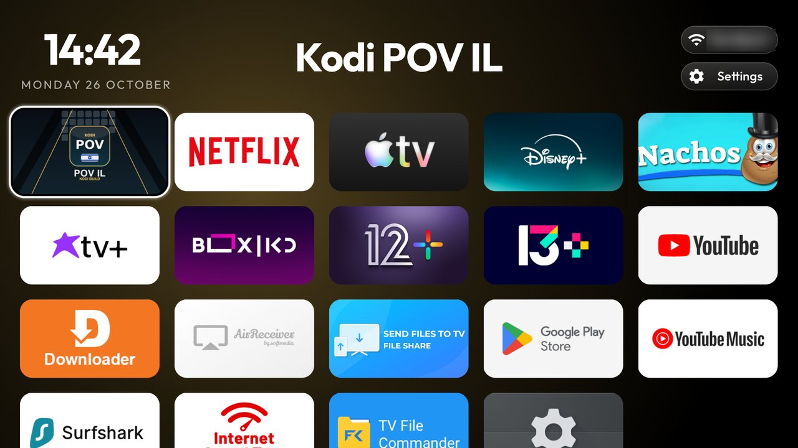

# cleanyourtv-header-grid

A fork of [cleanyourtv](https://github.com/Gathin23/cleanyourtv) with an Apple TV style layout without a dock, built and
used on four Xiaomi Mi Box S (MIBOX4): two on Android TV 12, two on Android TV 9. Push the
[`header-grid`](themes/header-grid/) theme to get the look:

    TV_HOST=<tv ip> tools/theme.sh themes/header-grid



Everything below is a launcher switch that is **off by default**, so the reference launcher looks and behaves as
upstream until a theme turns it on. Keys are documented in [`themes/README.md`](themes/README.md), screenshots in
[`docs/switches.md`](docs/switches.md).

| Switch | What it does |
|---|---|
| `header_stacked`, `header_side` | Clock centred over the date on the left, Wi-Fi above Settings as short pills on the right, equal side margins |
| `hero_in_header`, `hero_under_clock`, `hero_every_row` | The focused app's big name in the header (or under the clock) for every row, not only the dock; no small names |
| `tile_gap` | The grid runs exactly from the date's first letter to the buttons' right edge, with one even gap across and down |
| `visible_rows` | Exactly N rows on screen; Down scrolls a whole row at a time (also on the TV: Launcher settings > Rows on screen) |
| `grid_order` | The order of the grid after the dock apps |
| `focus_zoom`, `glass_style: double` | A bigger focus zoom and a black-and-white double focus frame that reads on white and dark banners |
| `hero_font`, `clock_font`, `dream_*` | Bold title and clock, and a bold, centred clock screensaver |
| `app_redirects` | When the firmware opens an app by itself, open another one instead. On Android 9 Mi Box S the LIVE button is routed to Live Channels before any key helper sees it, so `com.google.android.tv=<kodi package>` makes it a Kodi button |

Also: a **Theme** row in Launcher settings that switches between layouts built into the launcher
(`launcher/app/src/main/assets/presets/`) on top of the installed theme, keeping app order, remote buttons and the
screensaver; whole-row scrolling without the jump from RecyclerView's estimated scroll offset; and the Wi-Fi pill
re-measured when the network name arrives after the first layout.

Tested on: Xiaomi Mi Box S (MIBOX4), Android TV 12 (STTC.230106.001, firmware 4560) and Android TV 9 (PI.3595, PI.3933).
Launcher unit tests, lint and the release build pass; the APK is about 542 KB (gate 576 KB).

## Install with an agent

Paste this into a coding agent (Claude Code, Codex, Gemini CLI and the like) on a computer on the same network as
the TV box, with Developer options and USB or network debugging turned on in the box. Replace `<TV IP>` with the
box's address. The agent clones this fork, builds the launcher locally and installs it over ADB.

```text
I want to clean up and speed up my Android TV box (Xiaomi Mi Box S) and replace its home screen with the
header-grid launcher. My box's IP address is <TV IP>.

Use this repository: https://github.com/OrenDdp/cleanyourtv-header-grid (branch header-grid).
Clone it into this folder, then read AGENTS.md and PROMPT.md in it and follow PROMPT.md exactly. Its
safety rules come first: back up before any change, disable with "pm disable-user --user 0" only, never
uninstall, keep Android's core packages, and ask me before disabling anything I might use (streaming
apps, voice assistant, Chromecast, firmware updater).

Steps:
1. Check that ADB is installed; if not, install Android platform-tools. Connect with
   adb connect <TV IP>:5555 and tell me to accept the prompt on the TV. If it fails, tell me how to turn
   on USB/network debugging in Developer options.
2. Record the model, Android version and free memory as a "before" number.
3. Sort the installed packages into Required / Apps I use / Safe to disable / Ask me, with a one-line
   explanation each. Change nothing until I approve the list.
4. Disable only what I approved, in small batches, and save the list with re-enable commands.
5. Ask me what the remote's Home button should open:
   a) the new header-grid launcher, or
   b) Google's home screen as it is now (then the launcher is only an app in the apps list).
6. Build and install the launcher from launcher/ with its build-and-install script (it needs JDK 17 and
   the Android SDK; install them if missing). If I chose (a), make it Home only as the script does it,
   with its Home guard, and confirm Home works before disabling the stock launcher. If I chose (b), do not
   change Home and do not disable the stock launcher.
7. Ask me about the other remote buttons. List the buttons on my remote (press-test them with me if
   needed) and for each one ask whether to keep it as it is, make it open an app I choose (for example
   Kodi), or turn it off so it does nothing. Use the launcher's own settings for this (app_keys and the
   related keys in themes/README.md, with HOME_KEY_SERVICE=1 when the script needs it). If a button cannot
   be changed or turned off on this box, tell me instead of working around it. Test each change with me
   pressing the real remote, not an injected key.
8. Push the look with: tools/theme.sh themes/header-grid (or tools/theme.ps1 on Windows), adding the
   button settings from step 7 to a copy of that theme rather than editing the original.
9. Show free memory before and after, tell me how to undo everything, and at the end close ADB as
   PROMPT.md says.
```

Only the APK, without a computer: download
[`cleanyourtv-header-grid.apk`](https://github.com/OrenDdp/cleanyourtv-header-grid/releases/latest/download/cleanyourtv-header-grid.apk)
with Downloader and pick the look in Launcher settings > Theme. Without ADB the Home button keeps opening the
stock home screen, so the launcher opens from the apps list.
